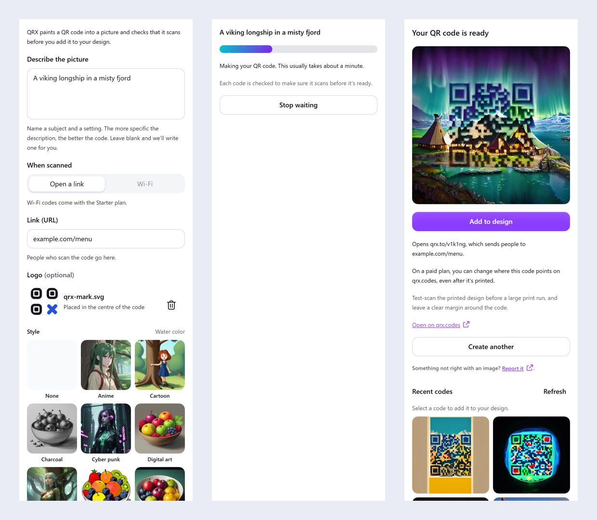

# QRX for Canva

A Canva app that paints a QR code into a picture, checks that it scans, and adds it to your design. The panel's
form is the QRX web app's: the same fields, wording and behaviour.

- **Connect a QRX account** through Canva's OAuth support. QRX uses Clerk as its identity provider; Canva stores and
  refreshes the tokens, so the app keeps none of its own.
- **Describe the picture, choose what the code does, add a logo, pick a style.** Every field is optional, as on
  qrx.codes: a blank description is filled with the example shown in it (the web app's list,
  `src/logic/example_descriptions.ts`), and a blank link with `<QRX_SITE_URL>/example`. The link field accepts
  `example.com/menu` and adds `https://`. Wi-Fi codes are offered when the account's plan has them
  (`GET /account`); the Wi-Fi details are never invented.
- **Logo (optional).** A PNG, JPEG, WebP or SVG chosen with the App UI Kit's `FileInput`, prepared in the panel as the
  web app does (SVGs rasterised, scaled to at most 1024 px, sent as a PNG so transparency is kept) and placed in the
  centre of the code. Files over 10 MB are turned away with "This image is too large; choose a smaller one".
- **Wait about a minute.** The app long-polls the QRX API and shows a progress bar paced to the usual time. Every code
  is decoded by QRX to check that it scans before it's returned.
- **Add to design.** The finished PNG is uploaded to the user's media (marked as AI-generated) and placed on the page.
  Recent codes can be added the same way.

Each code opens a hosted `qrx.to` short link that sends people to the user's page. On a paid plan, where it points can
be changed later on qrx.codes.



## Requirements

- Node.js 24 (`.nvmrc`) and npm 11
- A Canva developer account to preview the app in the editor (see [Previewing in Canva](#previewing-in-canva))

## Commands

```bash
npm install          # also copies .env.template to .env
npm start            # development server on http://localhost:8081
npm test             # Jest unit tests
npm run lint         # ESLint with Canva's app rules
npm run typecheck    # tsc
npm run build        # dist/app.js and dist/messages_en.json for the Developer Portal
npm run portal-config  # prints the Developer Portal auth settings and the CORS origin the API must allow
```

The bundle uploaded to the Developer Portal must be built against production:

```bash
QRX_API_BASE=https://qrx.codes npm run build
```

CI builds that bundle on every push and keeps it as the `canva-app-bundle` artifact.

## Configuration

Settings are read from the environment (and `.env`) at build time and compiled into the bundle by
`canva-app.config.ts`. None of them are secrets.

| Variable | Default | Meaning |
|---|---|---|
| `QRX_API_BASE` | `https://qrx.codes` | QRX API origin. `.env.template` sets `https://dev.qrx.codes` for development. |
| `QRX_API_MODE` | `canva` | `canva`: calls `/canva/v1/…` with the Canva user token in `Authorization` and the QRX token in `QRX_TOKEN_HEADER`, so the API can verify that requests come from this app. `direct`: calls `/v1/…` with the QRX token in `Authorization`. |
| `QRX_TOKEN_HEADER` | `X-QRX-Authorization` | Header for the QRX access token in `canva` mode (`Bearer <token>`). |
| `QRX_OAUTH_SCOPES` | `qrx:read qrx:generate offline_access` | Scopes requested on connect. |
| `QRX_OAUTH_RESOURCE` | `<QRX_API_BASE>/v1` | RFC 8707 `resource` added to the authorisation URL, so tokens are issued for the REST API. `none` sends none. |
| `QRX_OAUTH_PROVIDER` | (empty) | Provider name, if the Developer Portal lists more than one auth provider. |
| `QRX_SITE_URL` | `QRX_API_BASE` | Where "See plans" links go (only shown where Canva allows payments). |
| `CANVA_APP_ID`, `CANVA_APP_ORIGIN`, `CANVA_HMR_ENABLED` | | From the Developer Portal's `.env` file; used by the development server and `portal-config`. |
| `QRX_OAUTH_ISSUER`, `QRX_OAUTH_CLIENT_ID` | dev Clerk | Used only by `portal-config`. The client ID and secret are entered in the Developer Portal, never in the bundle. |

## How it talks to QRX

Built on the public REST API ([OpenAPI](https://qrx.codes/v1/openapi.json)):

| Step | Request |
|---|---|
| Styles | `GET {base}/styles` |
| Account | `GET {base}/account`, for whether the plan has Wi-Fi codes |
| Recent codes | `GET {base}/codes?limit=12` (finished link and Wi-Fi codes are shown) |
| Logo | `POST {base}/logos` with `{ image }` (the prepared PNG as a data URL), when one was chosen; answers the logo's `id` |
| Create | `POST {base}/codes` with `{ prompt, destination \| wifi, style?, logo? }` and an `Idempotency-Key`; retried once with the same key after a network failure, and after `409 idempotency-in-progress` |
| Wait | `GET {base}/codes/{id}?wait=25`, repeated until `succeeded` or `failed` (gives up waiting after 5 minutes; the code still appears in Recent codes) |

`{base}` is `/canva/v1` in `canva` mode and `/v1` in `direct` mode. A `401` triggers one forced token refresh and
retry; a second `401` returns the panel to the Connect state. Problem types (`daily-limit`, `rate-limited`,
`invalid-request`, …) map to the messages in `src/logic/errors.ts`.

Canva requires uploaded image URLs not to redirect. QRX image URLs may redirect to storage, so the app resolves the
final URL with a `HEAD` request before `upload()` and falls back to the original URL if it can't.

Prompts are checked with the same `obscenity` word filter the API uses before anything is sent.

## Previewing in Canva

1. Create an app in the [Developer Portal](https://www.canva.com/developers/apps) and copy its `.env` values
   (Security > Credentials) into `.env`.
2. Enable the `canva:asset:private:write` and `canva:design:content:write` permissions (they are also in
   `canva-app.json`).
3. Add the auth provider with the values from `npm run portal-config`, then copy the Redirect URL Canva shows into
   the Clerk OAuth application.
4. `npm start`, set **App source > Development URL** to `http://localhost:8081`, and click **Preview**.

The dev server's port is `CANVA_FRONTEND_PORT` in `.env` (8081 by default). Any free port works, as long as the
Development URL in the portal uses the same one.

Chrome asks before a public page such as canva.com loads anything from `localhost` (Local Network Access). Allow it
for Canva when Chrome prompts, or in the site settings for `https://www.canva.com`, or the app panel stays blank.

The QRX API must allow the app's origin (`https://app-<appid>.canva-apps.com`) in CORS, including the
`X-QRX-Authorization` header in `canva` mode, and the image host must allow it too.

## API prerequisites

The app is built against the documented contract; these pieces are on the QRX API side and must be live (dev first,
then prod) before the app works in Canva:

- **CORS** on `/v1` and `/canva/v1` for `https://app-<appid>.canva-apps.com` (each Canva app record has its own ID),
  allowing the `Authorization`, `Content-Type`, `Idempotency-Key` and (in `canva` mode) `X-QRX-Authorization` headers.
- **Logos:** `POST /v1/logos` and `logo` on `POST /v1/codes`. Until they are live on the
  API the app talks to, a code made with a logo is refused; without one, nothing changes.
- **Canva request verification** (`canva` mode): `/canva/v1/codes`, `/canva/v1/codes/{id}`, `/canva/v1/styles`,
  `/canva/v1/account` and `/canva/v1/logos`
  accept the Canva user token in `Authorization` (checked against Canva's JWKS for the app IDs) and the QRX access
  token in `X-QRX-Authorization: Bearer …`, and behave like the matching `/v1` routes. Not needed if Canva confirms
  OAuth alone is enough (`QRX_API_MODE=direct`).
- **Token audience:** tokens from Canva's sign-in must be accepted on those routes. Canva sends `resource` only on the
  authorise request, not the token request.
- **Images Canva can upload:** `imageUrl` must not redirect, or the redirect and the final host must allow the app's
  origin in CORS so the app can resolve it. Today `https://qrx.codes/media/premium/<id>.png` answers `302` to
  storage with CORS for `https://qrx.codes` only.
- **Style previews:** `/v1/styles` returns `previewUrl`s under `/images/styles/*.png`, which no longer exist on the
  site (the images are at `/img/styles/<name>-192.webp`). Until that's fixed, the panel falls back to a plain style list.

## Project layout

```
src/
  index.tsx                     registers the design editor intent
  intents/design_editor/        panel entry and App component
  api/                          QRX client, types, image URL resolution
  auth/use_qrx_auth.ts          Canva OAuth wrapper
  logic/                        validation, examples, logo preparation, polling, progress, error mapping
  components/                   form fields (scan, logo, style), progress, result, recent codes, alerts
  messages.ts                   every UI string (extracted for Canva's translation)
utils/qrx_config.ts             build-time settings
submission/                     Developer Portal listing pack and the tools that made its images
```

## Listing and review

Everything the Developer Portal asks for is in [`submission/`](submission/README.md): listing text, icons, featured
images, policy links, reviewer instructions and questionnaire answers.

## Licence

[MIT](LICENSE), except the files that came from Canva's app template (`canva-app.json`, `jest.setup.ts`,
`jest.config.mjs`, `eslint.config.mjs`, `tsconfig.json`, `scripts/copy_env.ts`, `declarations/declarations.d.ts`,
`src/utils/test_render.tsx` and `styles/components.css`), which stay under [Canva's licence](LICENSE-CANVA.md). That
licence limits their use to apps for the Canva platform.
