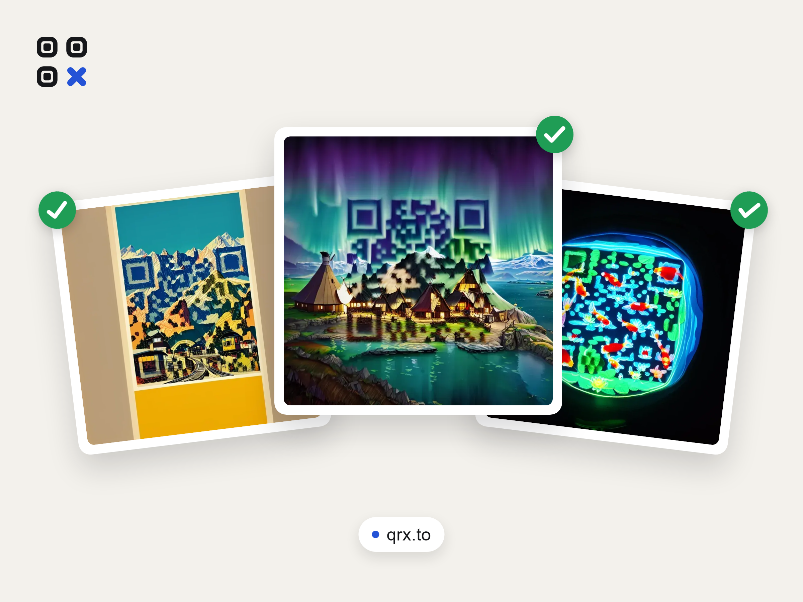
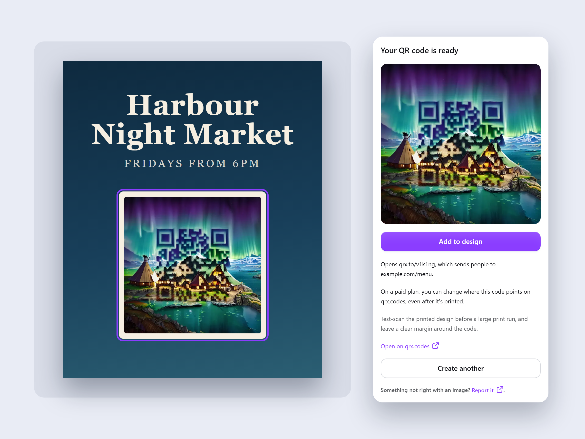
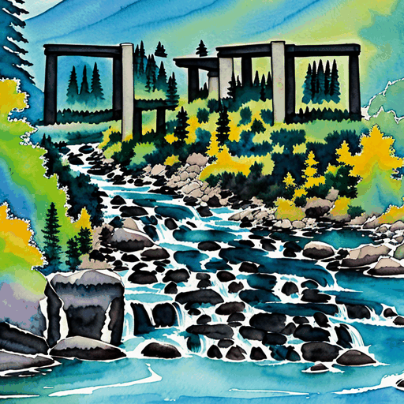
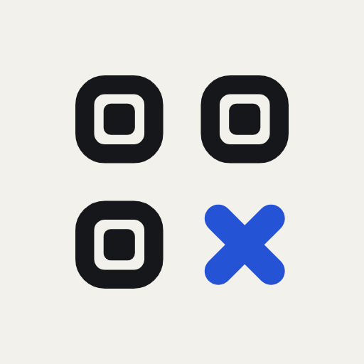

# Submission pack

Everything the Canva Developer Portal and the review need for the QRX app.

| File | For |
|---|---|
| [listing.md](listing.md) | Release > App listing details: name, short description, description, category, tags, media, links |
| [testing-instructions.md](testing-instructions.md) | Release > Testing instructions, including the reviewer login |
| [review-questionnaire.md](review-questionnaire.md) | Answers for the questionnaire in the review ticket, including AI and moderation |
| [question-to-canva.md](question-to-canva.md) | The question to send Canva before building further: is OAuth alone acceptable? |
| [owner-steps.md](owner-steps.md) | The steps that need the owner's accounts, in order |
| `icons/` | App icon, 512 x 512 (primary and alternative) |
| `featured/` | Featured images, 2400 x 1800 (editorial and contextual) |
| `screenshots/panel/` | The app panel in each state, light and dark, at 2x |
| `tools/` | The scripts that made the images |

## Images





| Icon | Alternative |
|---|---|
|  |  |

## Regenerating the images

The panel screenshots are the real app UI, rendered outside Canva by a harness that replaces the Canva SDK with
stand-ins and the QRX API with sample data (`tools/harness/`). Sample codes are QRX showcase images; the icon and mark
come from the QRX brand assets.

```bash
npx tsx submission/tools/harness/build.ts   # builds the harness page
python submission/tools/capture.py          # panel screenshots (Python Playwright + Chromium)
python submission/tools/compose.py          # icons and featured images
python submission/tools/overview.py         # screenshots/panel-overview.png for the README
```
